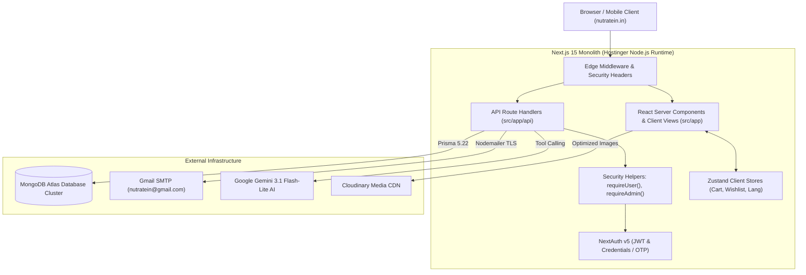
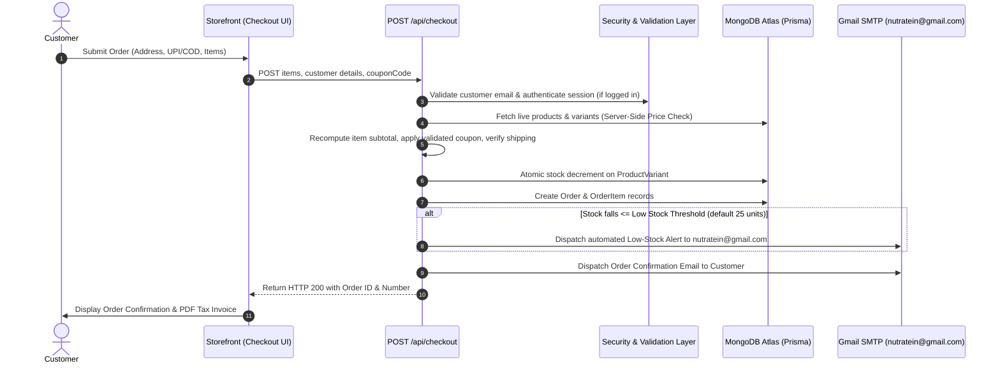
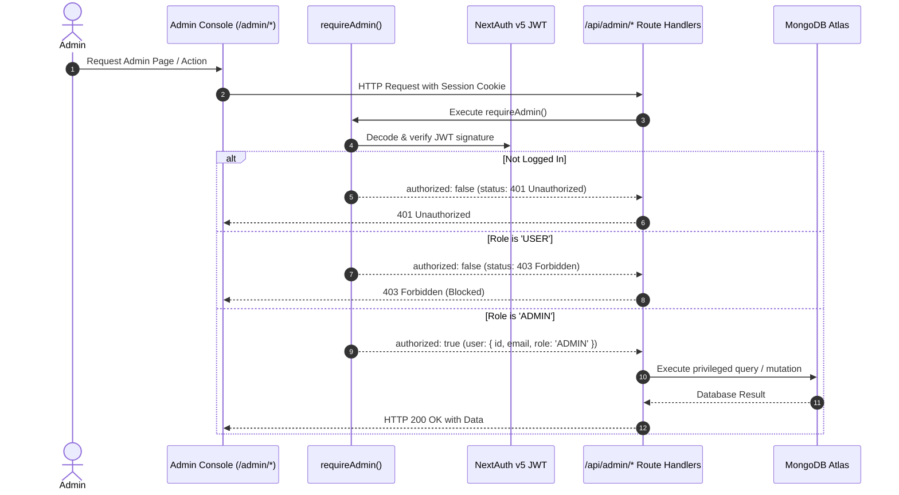

# NUTRATEIN — Technical Architecture Document

> **Platform**: NUTRATEIN E-Commerce Web Platform  
> **Production Target**: Hostinger Node.js Application / VPS (`nutratein.in`)  
> **Source Repository**: `NutraTein-Web`  
> **Document Version**: 2.0.0

---

## 1. Technical Stack Overview

| Layer | Technology | Version | Purpose / Notes |
| :--- | :--- | :--- | :--- |
| **Frontend Framework** | Next.js (App Router) | `15.5.25` | Server-side rendering, React Server Components (RSC), Edge routing. |
| **UI Library** | React | `19.2.8` | Component rendering, concurrent features, hooks. |
| **Language** | TypeScript | `5.9.3` | End-to-end static typing, strict mode enabled. |
| **Styling Engine** | Tailwind CSS | `3.4.17` | Utility-first styling with custom tokens, dark mode via `.dark` class. |
| **Database ORM** | Prisma Client & CLI | `5.22.0` | Type-safe query builder connected to MongoDB Atlas. |
| **Active Database** | MongoDB Atlas | Server v7.x | Cloud document database, replica set with automated indexing. |
| **Authentication** | NextAuth.js | `5.0.0-beta.25` | JWT session strategy, credentials, Email OTP, and Phone OTP. |
| **Password Hashing** | bcryptjs | `3.0.3` | Salted credential hashing (12 rounds). |
| **Email Transport** | Nodemailer | `6.10.1` | SMTP client connected to Google Workspace / Gmail (`nutratein@gmail.com`). |
| **AI Engine** | Google Generative AI SDK | `0.24.1` | Gemini 3.1 Flash-Lite with database tool-calling integration. |
| **State Management** | Zustand | `5.0.15` | Client-side stores for Cart, Wishlist, Compare, and Language. |
| **Form Validation** | React Hook Form & Zod | `7.87.0` / `4.5.4` | Schema-driven input validation. |
| **Media Hosting** | Cloudinary / Public Storage | `v2` API | Optimized delivery for product photography and banners. |
| **Icons & Visuals** | Lucide React | `1.39.0` | Comprehensive icon library. |
| **Toast Notifications**| Sonner | `2.0.8` | Accessible, stacked toast alerts. |

---

## 2. Critical Database Architecture & Inconsistency Resolution

### The Source of Truth
The **active, authoritative database for NUTRATEIN is MongoDB Atlas**, accessed exclusively through **Prisma ORM** via the configuration in [`prisma/schema.prisma`](file:///d:/Git%20Upload/NutraTein-Web/prisma/schema.prisma):

```prisma
datasource db {
  provider = "mongodb"
  url      = env("DATABASE_URL")
}
```

### Explaining Past Inconsistencies & Legacy Files
1. **The `backend/` Folder (Mongoose / Express)**:  
   During early prototyping, the project had an Express 5 + Mongoose backend in `backend/` under the working title `PROTEINX`.  
   *Current Status*: **Deprecated**. The entire active application runs within the Next.js 15 App Router under `src/app/api/`. Do not run or route traffic to `backend/server.js`.
2. **The `frontend/` Folder (Vanilla HTML/CSS/JS)**:  
   An early static prototype (`index.html`, `shop.html`, etc.) exists in `frontend/`.  
   *Current Status*: **Deprecated**. Rewrites in [`next.config.js`](file:///d:/Git%20Upload/NutraTein-Web/next.config.js) safely map any legacy `.html` requests to the appropriate Next.js dynamic pages.
3. **The `supabase_schema.sql` and `prisma/schema.postgresql.prisma` Files**:  
   A migration to Supabase PostgreSQL was previously contemplated and documented in `MIGRATION_STRATEGY.md`, but was **never executed**.  
   *Current Status*: **Unexecuted Blueprint**. Do NOT switch `provider` or attempt database migration without explicit, written authorization. All live data resides in MongoDB Atlas.

---

## 3. High-Level System Architecture Diagram



---

## 4. End-to-End Data Flows

### A. Customer Checkout & Inventory Depletion Flow


### B. Administrative Authorization & Access Control Flow


---

## 5. Repository Directory Structure

```text
NutraTein-Web/
├── .antigravity/                   # AI workspace rules
│   └── rules.md                    # Core engineering rules & guardrails
├── docs/                           # Master project documentation
│   ├── PRD.md                      # Product Requirements Document
│   ├── ARCHITECTURE.md             # This document
│   ├── DESIGN_SYSTEM.md            # Visual design tokens & responsive rules
│   ├── PROJECT_CONTEXT.md          # Persistent project state & memory
│   ├── CODING_RULES.md             # Strict engineering standards
│   ├── TASKS.md                    # Task progress tracker
│   ├── API_REFERENCE.md            # Exhaustive API routes reference
│   ├── DATABASE_SCHEMA.md          # 31 Prisma data models & relations
│   ├── TESTING_AND_DEPLOYMENT.md   # Build, verification & deployment manual
│   ├── CHANGELOG.md                # Chronological change records
│   └── SECURITY_MANUAL_TEST_PLAN.md# Security verification procedures
├── prisma/                         # Database schema & migrations
│   ├── schema.prisma               # Active Prisma schema (MongoDB provider)
│   └── seed.ts                     # Database seeding script
├── public/                         # Public static assets & images
├── src/                            # Application source code
│   ├── app/                        # Next.js 15 App Router
│   │   ├── (auth)/                 # Login, Register, Forgot Password
│   │   ├── (store)/                # Storefront (Shop, Cart, Checkout, Deals)
│   │   ├── account/                # Customer Account Portal
│   │   ├── admin/                  # Administrative Management Console
│   │   ├── api/                    # 60+ API Route Handlers
│   │   ├── layout.tsx              # Root HTML & body layout
│   │   └── globals.css             # Global CSS & Tailwind components
│   ├── components/                 # Reusable React components
│   │   ├── admin/                  # Admin UI managers (Orders, Email, Staff)
│   │   ├── cart/                   # CartDrawer, cart items
│   │   ├── chat/                   # AI Chatbot & WhatsApp floating widget
│   │   ├── home/                   # Homepage sections (Hero, Coverflow, Combos)
│   │   ├── layout/                 # Header, Footer, AnnouncementBar
│   │   ├── product/                # ProductCard, ProductGallery, Details
│   │   └── ui/                     # Primitives (modals, buttons, carousels)
│   ├── data/                       # Static CMS data & feature configs
│   │   ├── feature-flags.json      # Master toggles for Subscriptions & Loyalty
│   │   ├── store-settings.json     # Brand ribbons, support email, phone
│   │   └── loyalty-config.json     # Point earning & redemption rates
│   ├── lib/                        # Server utilities & helper functions
│   │   ├── auth.ts                 # NextAuth v5 configuration
│   │   ├── feature-flags.ts        # Storefront feature flag helpers
│   │   ├── prisma.ts               # Global Prisma client singleton
│   │   ├── security.ts             # requireUser(), requireAdmin() guards
│   │   └── sendEmail.ts            # Nodemailer Gmail SMTP transport
│   ├── locales/                    # Pre-translated localization files
│   │   ├── en.json                 # English
│   │   ├── hi.json                 # Hindi
│   │   ├── mr.json                 # Marathi
│   │   └── ta.json                 # Tamil
│   ├── store/                      # Zustand client stores
│   │   ├── cart.ts                 # Persistent cart state
│   │   ├── wishlist.ts             # Wishlist store
│   │   └── language.ts             # Active locale store
│   └── types/                      # Shared TypeScript definitions
├── next.config.js                  # Next.js runtime, headers, image domains
├── package.json                    # Dependencies & execution scripts
├── tailwind.config.js              # Tailwind tokens, breakpoints, colors
└── tsconfig.json                   # TypeScript compiler options
```

---

## 6. Background Jobs & Scheduled Workers

1. **Abandoned Cart Follow-Up Cron** (`/api/cron/abandoned-cart`):
   - Protected by `CRON_SECRET` Bearer header via `requireCronSecret()`.
   - Scans cart records older than 24 hours without completed orders and dispatches reminder notifications.
2. **Low-Stock Depletion Trigger**:
   - Event-driven worker in [`src/app/api/checkout/route.ts`](file:///d:/Git%20Upload/NutraTein-Web/src/app/api/checkout/route.ts).
   - Executed immediately following order creation when a variant's remaining units drop $\le$ the configured threshold.
