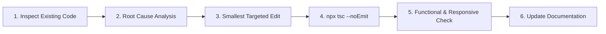

# NUTRATEIN — Non-Negotiable Coding Rules & Engineering Standards

> **Applies to**: All AI Agents, Pair Programmers, and Human Contributors  
> **Repository**: NUTRATEIN Web Platform  
> **Document Version**: 2.0.0

---

## 1. Preserve the Existing Technology Stack

1. **Database Lock**:
   - The production database is **MongoDB Atlas** accessed via **Prisma ORM 5.22**.
   - Do **NOT** replace Prisma with Mongoose, Supabase, Drizzle, or raw MongoDB drivers.
   - Do **NOT** execute database migrations or switch schema providers unless explicitly authorized in writing.
2. **Framework Lock**:
   - The platform is built strictly on **Next.js 15 (App Router)** and **React 19**.
   - Do not downgrade Next.js or introduce Pages Router patterns.
3. **Dependency Discipline**:
   - Do **NOT** install new npm packages without stating the package name, justification, and awaiting explicit user approval.
   - Reuse existing libraries already installed: `@google/generative-ai`, `bcryptjs`, `clsx`, `framer-motion`, `lucide-react`, `nodemailer`, `recharts`, `sonner`, `tailwind-merge`, `zod`, `zustand`.
4. **Zero Duplication**:
   - Do not write new helper functions when canonical utilities exist (e.g., use `requireUser()` / `requireAdmin()` from `@/lib/security`, `sendMail()` from `@/lib/sendEmail`, `prisma` from `@/lib/prisma`).

---

## 2. Preserve Existing Functionality & User Experience

1. **No Silent Feature Removal**: Never delete existing pages, admin controls, or customer features.
2. **Strict Scope Isolation**: When fixing a bug on one component or route, do not edit unrelated pages, layouts, or stylesheets.
3. **API Contract Stability**: Never alter the response schema or status codes of existing API endpoints without verifying all frontend consumers.
4. **Financial Calculation Integrity**:
   - Never trust prices, totals, discounts, or stock numbers provided by client requests.
   - All monetary amounts must be computed strictly on the server from fresh database records.
5. **Preserve Visual Design & Branding**:
   - Retain the brand color palette (`brand-600` `#ea580c`, `zinc-950` `#09090b`).
   - Maintain the `object-contain` rule for product packaging images to prevent label cropping.

---

## 3. Data Protection, Security & Secrets Hygiene

1. **Zero Secret Leaks**:
   - Never hardcode API keys, passwords, database URIs, or tokens in source code.
   - Never print raw secrets in chat, task outputs, or markdown files. Always mask values (e.g., `mong****`, `ee****`).
2. **Environment Variable Privacy**:
   - Server-only secrets (`DATABASE_URL`, `AUTH_SECRET`, `GEMINI_API_KEY`, `SMTP_PASS`) must never be prefixed with `NEXT_PUBLIC_`.
   - Never expose server environment variables to the browser runtime.
3. **Authorization & IDOR Defense**:
   - Every protected API route must enforce server-side authentication (`requireUser()` or `requireAdmin()`).
   - When querying user-owned records (orders, wishlist, addresses, subscriptions, points), always filter by the session user's ID derived from the authenticated session, never from an unverified client parameter.
4. **Destructive Database Operations**:
   - Never execute `prisma db push`, `prisma migrate`, or drop collections without showing the exact schema diff and obtaining written user approval.

---

## 4. The Safe Modification Workflow

Every coding task must follow this disciplined 6-step lifecycle:

### Step 1: Inspect Before Acting
- Search and read the actual implementation files before proposing or writing code.
- Check `docs/PROJECT_CONTEXT.md` and `docs/ARCHITECTURE.md` to avoid contradicting established patterns.

### Step 2: Root Cause Analysis & Blast Radius Check
- Identify why the bug occurs or why the feature is needed.
- Determine which components, route handlers, and database models are affected.

### Step 3: Implement the Smallest Appropriate Change
- Make precise, surgical modifications.
- Preserve existing comments and docstrings.

### Step 4: Mandatory Type Check
- Execute `npx tsc --noEmit`.
- Verify that the command exits with **0 errors**. Fix any type discrepancies immediately.

### Step 5: Functional & Responsive Verification
- Verify the change in both light mode and dark mode.
- Confirm zero horizontal overflow across mobile (375px), tablet (768px), and desktop (1280px) viewports.

### Step 6: Maintain Project Memory
- Update `docs/TASKS.md` to reflect task completion.
- If an architectural rule or API contract was modified, update the relevant documentation.
