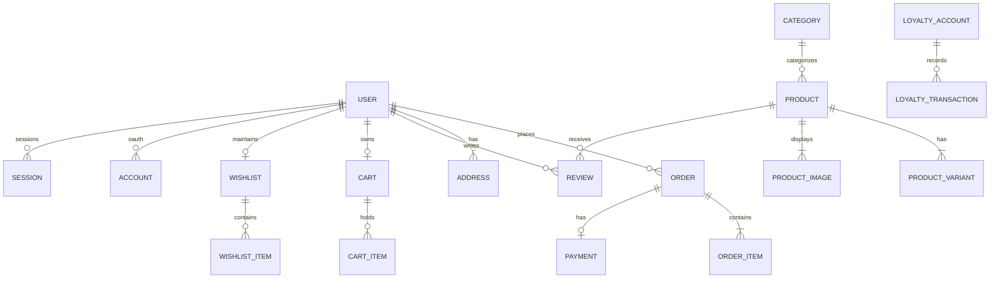

# NUTRATEIN — Database Schema & Data Models Documentation

> **Active Database**: MongoDB Atlas Cluster (Replica Set)  
> **ORM & Schema Provider**: Prisma Client 5.22.0 (`prisma/schema.prisma`)  
> **Datasource Provider**: `mongodb`  
> **Document Version**: 2.0.0

---

## 1. Architectural Database Confirmation

1. **Active Database Engine**:
   - The production database for NUTRATEIN is **MongoDB Atlas**.
   - Connected via connection string in `.env`: `DATABASE_URL="mongodb+srv://..."`.
   - Managed strictly through Prisma Client (`provider = "mongodb"`).
2. **Clarification on Historical / Legacy Artifacts**:
   - `backend/models/`: Contains early Mongoose schemas (`User.js`, `Product.js`, `Order.js`). These are **legacy prototype files** from the previous Express backend and are not used by the running Next.js application.
   - `supabase_schema.sql` & `prisma/schema.postgresql.prisma`: These files represent a previously planned, unexecuted PostgreSQL migration blueprint. They are **not active**.
   - **Do not alter or migrate the database**. The live production application relies 100% on MongoDB Atlas.

---

## 2. Prisma Models & Collections Inventory (31 Models)

---

## 3. Detailed Data Models

### A. Authentication & User Management

#### `model User` (Collection: `User`)
- Represents customer accounts and administrators.
- **Fields**:
  - `id`: `String` `@id @default(auto()) @map("_id") @db.ObjectId`
  - `name`: `String?` — Customer's full name.
  - `email`: `String` `@unique` — Unique login email address.
  - `emailVerified`: `DateTime?` — Timestamp of email verification.
  - `image`: `String?` — Profile avatar URL.
  - `password`: `String?` — Bcrypt-hashed password (12 rounds).
  - `phone`: `String?` — 10-digit mobile number.
  - `whatsappOptIn`: `Boolean` `@default(true)` — WhatsApp notification consent.
  - `role`: `String` `@default("USER")` — Access tier: `"USER"` or `"ADMIN"`.
  - `createdAt`: `DateTime` `@default(now())`
  - `updatedAt`: `DateTime` `@updatedAt`
- **Relations**: `accounts`, `sessions`, `cart`, `wishlist`, `orders`, `addresses`, `reviews`.
- **Sensitive Fields**: `password` (never exposed in API responses).

#### `model Account` (Collection: `Account`)
- NextAuth OAuth identity providers (Google, etc.).
- **Fields**: `id`, `userId` (`@db.ObjectId`), `type`, `provider`, `providerAccountId`, `refresh_token`, `access_token`, `expires_at`, `token_type`, `scope`, `id_token`.
- **Constraint**: `@@unique([provider, providerAccountId])`.

#### `model Session` (Collection: `Session`)
- NextAuth database session records (when database session strategy is invoked).
- **Fields**: `id`, `sessionToken` (`@unique`), `userId` (`@db.ObjectId`), `expires`.

#### `model EmailOTP` (Collection: `EmailOTP`)
- Cryptographic OTP verification codes for passwordless email login.
- **Fields**:
  - `id`: `String` `@id @default(auto()) @map("_id") @db.ObjectId`
  - `email`: `String`
  - `code`: `String` — SHA-256 hashed 6-digit numeric OTP.
  - `expiresAt`: `DateTime`
  - `createdAt`: `DateTime` `@default(now())`
- **Index**: `@@index([email])`.

#### `model PhoneOTP` (Collection: `PhoneOTP`)
- SMS/Phone-based verification codes.
- **Fields**: `id`, `phone`, `code` (SHA-256 hash), `expiresAt`, `createdAt`.
- **Index**: `@@index([phone])`.

---

### B. Catalog & Products

#### `model Category` (Collection: `Category`)
- Product categories (Whey, Creatine, Mass Gainer) and Fitness Goals.
- **Fields**:
  - `id`: `String` `@id @default(auto()) @map("_id") @db.ObjectId`
  - `name`: `String`
  - `slug`: `String` `@unique`
  - `description`: `String?`
  - `image`: `String?`
  - `icon`: `String?`
  - `type`: `String` `@default("PRODUCT")` — `"PRODUCT"` or `"GOAL"`.
  - `order`: `Int` `@default(0)`
  - `isActive`: `Boolean` `@default(true)`
- **Relations**: `products`.

#### `model Product` (Collection: `Product`)
- Core supplement product entity.
- **Fields**:
  - `id`: `String` `@id @default(auto()) @map("_id") @db.ObjectId`
  - `name`: `String`
  - `slug`: `String` `@unique`
  - `description`: `String`
  - `shortDescription`: `String?`
  - `basePrice`: `Float` — Reference MRP/starting price.
  - `compareAtPrice`: `Float?` — Strikethrough price for discount display.
  - `categoryId`: `String` `@db.ObjectId`
  - `tags`: `String[]` — e.g., `["whey", "isolate", "bestseller"]`.
  - `isActive`: `Boolean` `@default(true)`
  - `isFeatured`: `Boolean` `@default(false)`
  - `isNewArrival`: `Boolean` `@default(false)`
  - `isBestSeller`: `Boolean` `@default(false)`
  - `rating`: `Float` `@default(0)`
  - `reviewCount`: `Int` `@default(0)`
  - `nutritionalInfo`: `Json?` — Per-serving protein, calories, BCAAs.
  - `ingredients`: `String?`
  - `usageInstructions`: `String?`
- **Relations**: `category`, `variants`, `images`, `reviews`.
- **Index**: `@@index([categoryId])`, `@@index([slug])`.

#### `model ProductVariant` (Collection: `ProductVariant`)
- Specific SKU combinations (Flavor + Container Size/Weight).
- **Fields**:
  - `id`: `String` `@id @default(auto()) @map("_id") @db.ObjectId`
  - `productId`: `String` `@db.ObjectId`
  - `name`: `String` — e.g., `"Chocolate Fudge / 1kg (2.2 lbs)"`.
  - `sku`: `String` `@unique`
  - `price`: `Float` — Authoritative server selling price.
  - `compareAtPrice`: `Float?`
  - `inventory`: `Int` `@default(0)` — Current physical stock count.
  - `weight`: `String?` — e.g., `"1kg"`, `"2kg"`.
  - `flavor`: `String?` — e.g., `"Double Rich Chocolate"`, `"Cafe Latte"`.
  - `isDefault`: `Boolean` `@default(false)`
- **Constraint**: `@@unique([productId, name])`.

#### `model ProductImage` (Collection: `ProductImage`)
- Product photography and packaging renders.
- **Fields**: `id`, `productId` (`@db.ObjectId`), `url`, `alt`, `isPrimary` (`@default(false)`), `order`.

---

### C. Cart, Wishlist & Customer Saved Data

#### `model Cart` & `model CartItem` (Collections: `Cart`, `CartItem`)
- Persistent server carts for logged-in users.
- **Fields**: `id`, `cartId`, `productId`, `variantId`, `quantity`.

#### `model Wishlist` & `model WishlistItem` (Collections: `Wishlist`, `WishlistItem`)
- Saved customer favorite items.

#### `model Address` (Collection: `Address`)
- Customer saved shipping and billing destinations.
- **Fields**: `id`, `userId` (`@db.ObjectId`), `name`, `phone`, `street`, `landmark`, `city`, `state`, `pincode`, `isDefault`.

---

### D. Orders & Payments

#### `model Order` (Collection: `Order`)
- Customer orders with fulfillment lifecycle.
- **Fields**:
  - `id`: `String` `@id @default(auto()) @map("_id") @db.ObjectId`
  - `orderNumber`: `String` `@unique` — e.g., `"NT-20261018-4921"`.
  - `userId`: `String?` `@db.ObjectId` — Nullable for guest checkouts.
  - `guestEmail`: `String?`
  - `status`: `String` `@default("PLACED")` — `"PLACED"`, `"CONFIRMED"`, `"PROCESSING"`, `"SHIPPED"`, `"DELIVERED"`, `"CANCELLED"`.
  - `paymentStatus`: `String` `@default("PENDING")` — `"PENDING"`, `"PAID"`, `"FAILED"`, `"REFUNDED"`.
  - `paymentMethod`: `String` — `"UPI"`, `"COD"`, `"CASH"`.
  - `subtotal`: `Float`
  - `discount`: `Float` `@default(0)`
  - `shipping`: `Float` `@default(0)`
  - `tax`: `Float` `@default(0)`
  - `total`: `Float` — Final calculated payable amount.
  - `couponCode`: `String?`
  - `shippingAddress`: `Json` — Snapshot of delivery address at checkout.
  - `notes`: `String?`
  - `createdAt`: `DateTime` `@default(now())`
- **Relations**: `user`, `items`, `payment`.

#### `model OrderItem` (Collection: `OrderItem`)
- Snapshot of items in an order.
- **Fields**: `id`, `orderId` (`@db.ObjectId`), `productId`, `variantId`, `productName`, `variantName`, `price`, `quantity`, `total`, `image`.

#### `model PaymentMethod` (Collection: `PaymentMethod`)
- Administrative UPI & QR payment destinations.
- **Fields**: `id`, `type` (`"UPI_QR"`, `"NET_BANKING"`), `name`, `upiId`, `accountNumber`, `ifscCode`, `qrCodeUrl`, `isActive`.

---

### E. Subscriptions & Loyalty

#### `model Subscription` (Collection: `Subscription`)
- Customer recurring supplement delivery contracts.
- **Fields**:
  - `id`: `String` `@id @default(auto()) @map("_id") @db.ObjectId`
  - `userId`: `String` `@db.ObjectId`
  - `productId`: `String` `@db.ObjectId`
  - `variantId`: `String?`
  - `frequency`: `String` — `"BIWEEKLY"`, `"MONTHLY"`, `"BIMONTHLY"`, `"QUARTERLY"`.
  - `quantity`: `Int` `@default(1)`
  - `basePrice`: `Float`
  - `discountPercent`: `Float` `@default(10)`
  - `status`: `String` `@default("ACTIVE")` — `"ACTIVE"`, `"PAUSED"`, `"CANCELLED"`.
  - `nextDeliveryDate`: `DateTime`
  - `createdAt`: `DateTime` `@default(now())`

#### `model LoyaltyAccount` & `model LoyaltyTransaction`
- Customer loyalty coin balances and audit trail.
- **Fields (Account)**: `id`, `userId` (`@unique`), `points` (`Int`), `totalEarned`, `totalRedeemed`.
- **Fields (Transaction)**: `id`, `userId`, `orderId`, `amount`, `type` (`"EARNED"`, `"REDEEMED"`, `"ADJUSTED"`), `balanceBefore`, `balanceAfter`, `description`.

---

### F. Governance, CMS & Audit

#### `model AuditLog` (Collection: `AuditLog`)
- Immutable record of privileged admin actions.
- **Fields**: `id`, `adminId`, `adminEmail`, `action`, `resource`, `resourceId`, `details` (`Json?`), `ipAddress`, `createdAt`.

#### `model SocialLink` (Collection: `SocialLink`)
- Official brand channels (`YouTube`, `Facebook`, `Videos`, `Instagram`).
- **Fields**: `id`, `platform`, `url`, `isActive` (`Boolean @default(true)`).

#### `model Coupon` (Collection: `Coupon`)
- Discount promo codes.
- **Fields**: `id`, `code` (`@unique`), `discountType` (`"PERCENTAGE"`, `"FIXED"`), `discountValue`, `minOrderAmount`, `maxDiscount`, `startDate`, `endDate`, `usageLimit`, `usedCount`, `isActive`.
