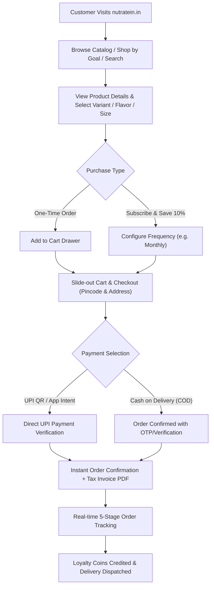

# NUTRATEIN — Product Requirements Document (PRD)

> **Document Version**: 2.0.0  
> **Last Updated**: October 18, 2026  
> **Target Production Domain**: `nutratein.in`  
> **Platform Classification**: D2C Sports Nutrition & Supplement E-Commerce Platform

---

## 1. Project Overview & Business Purpose

NUTRATEIN is a direct-to-consumer (D2C) health, sports nutrition, and wellness e-commerce platform based in Maharashtra, India. The platform is designed to provide gym-goers, athletes, fitness enthusiasts, and health-conscious consumers with 100% authentic, lab-certified nutritional supplements (including Whey Protein Isolate, Mass Gainers, Micronized Creatine, Pre-Workout formulations, BCAAs, and daily multivitamins).

The platform eliminates middlemen, addresses widespread supplement counterfeiting in the Indian market by shipping directly from certified manufacturing facilities, and provides a modern digital experience featuring multi-language accessibility (English, Hindi, Marathi, Tamil), AI-assisted customer consultation, automated recurring deliveries (subscriptions), and customer loyalty rewards.

---

## 2. Business Objectives

1. **Brand Authenticity & Consumer Trust**: Guarantee zero counterfeit supplements with transparent lab certifications and batch tracking.
2. **Direct-to-Consumer (D2C) Economics**: Eliminate retail distribution markups, offering premium grade formulations at competitive consumer pricing.
3. **High Customer Lifetime Value (LTV)**: Drive repeat purchase velocity via automated recurring delivery subscriptions (saving 10%) and a points-based loyalty program.
4. **Zero Re-Acquisition Costs**: Retain existing athletes through automated replenishment alerts, subscription convenience, and milestone reward coins.
5. **Pan-India Accessibility**: Deliver an inclusive shopping journey across linguistic demographics with native translations in English, Hindi, Marathi, and Tamil.
6. **Frictionless Conversion**: Streamline mobile checkout with dynamic UPI QR intent, Cash on Delivery (COD), pincode delivery validation, and real-time order tracking.

---

## 3. Target User Groups

1. **Fitness Athletes & Bodybuilders**: High supplement literacy; purchase monthly whey isolates, creatine, and pre-workouts; value purity certificates, amino profiles, and repeat delivery reliability.
2. **Recreational Gym-Goers & Beginners**: Developing fitness habits; require educational guidance, daily protein intake calculations, and stack recommendations.
3. **Health & Wellness Shoppers**: Focused on daily immunity, vitamins, and recovery; prioritize clean ingredients, FSSAI compliance, and hassle-free returns.
4. **Store Administrators & Operations Staff**: Require end-to-end catalog management, inventory control, automated low-stock warnings, order status fulfillment, and promotional CMS governance.

---

## 4. User Personas & Needs

### Persona 1: Vikram (The Dedicated Lifter)
- **Age**: 26 | **Location**: Pune, Maharashtra | **Language**: English / Marathi
- **Goals**: Muscle hypertrophy, high daily protein intake, reliable monthly deliveries.
- **Pain Points**: Fear of fake protein tubs; forgetting to order before the current tub empties.
- **Needs**: Monthly auto-delivery subscription with 10% discount, instant UPI payment, batch lab report visibility.

### Persona 2: Priya (The Fitness Beginner)
- **Age**: 22 | **Location**: Indore, Madhya Pradesh | **Language**: Hindi
- **Goals**: General fitness, lean toning, stamina enhancement.
- **Pain Points**: Confused by overwhelming supplement terminology; uncertain how much protein is required daily.
- **Needs**: Interactive daily protein calculator, AI chatbot guidance in Hindi, bundled "Starter Stack", Cash on Delivery option.

### Persona 3: Adnan / Store Administrator (The Business Owner)
- **Role**: NutraTein Operations Manager | **Location**: Mumbai
- **Goals**: Real-time order fulfillment, zero stockouts, profitable repeat customer base.
- **Needs**: Instant email notification on stock falling below threshold (default 25 units), live category and banner CMS, staff access control, unified subscriptions and loyalty control.

---

## 5. Main Customer Journeys

---

## 6. Functional Requirements Matrix

| Requirement ID | Feature Area | Description | Priority | Current Status |
| :--- | :--- | :--- | :--- | :--- |
| **PRD-001** | Product Catalog | Filterable catalog by category, goal, price range, and search keyword. | P0 | **Implemented & Verified** |
| **PRD-002** | Product Detail Pages | Dynamic slug pages (`/shop/[slug]`) showing ingredients, flavors, sizes, stock status, and reviews. | P0 | **Implemented & Verified** |
| **PRD-003** | Live Search Modal | Instant keyword search across products with thumbnails, pricing, and category filters. | P0 | **Implemented & Verified** |
| **PRD-004** | Cart & Drawer | Slide-out cart drawer with quantity adjustments, free shipping progress bar (₹999 threshold), and subtotal computation. | P0 | **Implemented & Verified** |
| **PRD-005** | Checkout & Tax Calculation | Server-verified checkout calculating item subtotals, coupons, shipping, and total amounts. | P0 | **Implemented & Verified** |
| **PRD-006** | UPI & QR Payments | Server-managed UPI profiles with dynamic QR code generation, transaction ID capture, and admin verification. | P0 | **Implemented & Verified** |
| **PRD-007** | Cash on Delivery (COD) | COD order processing with server-side validation and stock reservation. | P0 | **Implemented & Verified** |
| **PRD-008** | Order Tracking | 5-stage shipment timeline (`PLACED` → `CONFIRMED` → `PROCESSING` → `SHIPPED` → `DELIVERED`). | P0 | **Implemented & Verified** |
| **PRD-009** | Printable Tax Invoice | PDF/Print-ready tax invoice with company GSTIN, itemized rates, discounts, and customer details. | P1 | **Implemented & Verified** |
| **PRD-010** | Customer Authentication | Email/Password, Email OTP, and Phone OTP authentication via NextAuth v5 JWT strategy. | P0 | **Implemented & Verified** |
| **PRD-011** | Customer Account Area | Dashboard, My Orders, Saved Addresses, Profile Settings, and Wishlist. | P0 | **Implemented & Verified** |
| **PRD-012** | Recurring Subscriptions | Recurring delivery subscription engine with frequencies (Biweekly, Monthly, Bimonthly, Quarterly) and 10% discount. | P1 | **Implemented & Verified** |
| **PRD-013** | Loyalty & Rewards | Points accumulation on orders (configurable rate) and checkout discount redemption. | P1 | **Implemented & Verified** |
| **PRD-014** | Subscriptions & Loyalty Toggles | Unified admin control center to independently toggle Subscriptions and Loyalty ON/OFF on the storefront. | P0 | **Implemented & Verified** |
| **PRD-015** | Product Comparison | Side-by-side comparison of up to 3 supplement products (protein per scoop, calories, price per gram). | P2 | **Implemented & Verified** |
| **PRD-016** | Daily Protein Calculator | Formula-based daily protein intake estimator based on body weight, activity level, and fitness goals. | P2 | **Implemented & Verified** |
| **PRD-017** | Custom Combo Builder | Interactive supplement bundle stack builder with tiered bundle savings. | P2 | **Implemented & Verified** |
| **PRD-018** | Multi-Language Support | Four pre-translated locales: English (`en`), Hindi (`hi`), Marathi (`mr`), Tamil (`ta`). Zero runtime API latency. | P1 | **Implemented & Verified** |
| **PRD-019** | AI Chatbot Advisor | Gemini 3.1 Flash-Lite customer assistant with database tool-calling for live products, coupons, and orders. | P1 | **Implemented & Verified** |
| **PRD-020** | Low-Stock Email Alerts | Automated email notification to `nutratein@gmail.com` when variant inventory drops $\le$ manual threshold (default 25 units). | P0 | **Implemented & Verified** |
| **PRD-021** | Admin Category Manager | Management interface for category creation, editing, icon updates, and click-to-shop redirection. | P0 | **Implemented & Verified** |
| **PRD-022** | Social Media Links Manager | CMS for managing active brand social channels (YouTube, Facebook, Videos, Instagram) with live links. | P1 | **Implemented & Verified** |
| **PRD-023** | Hero Banners & Announcements CMS | Dynamic announcement banner manager with multi-ribbon rotation and call-to-action routing. | P1 | **Implemented & Verified** |
| **PRD-024** | Customer Reviews & Ratings | Star ratings and text reviews with admin approval/moderation controls. | P1 | **Implemented & Verified** |
| **PRD-025** | Pincode Delivery Estimator | Delivery timeline estimation and COD availability check based on Indian postal codes. | P2 | **Implemented & Verified** |

---

## 7. Non-Functional Requirements

- **Performance**: First Contentful Paint (FCP) $\le 1.2s$; Largest Contentful Paint (LCP) $\le 2.5s$; Cumulative Layout Shift (CLS) $\le 0.05$.
- **Security**: Strict role-based access control (`requireUser()`, `requireAdmin()`); zero IDOR vulnerabilities; SHA-256 hashed OTPs; TLS SMTP dispatch; masked secrets.
- **Availability**: 99.9% uptime target hosted on Hostinger Node.js Application / VPS infrastructure with MongoDB Atlas multi-AZ replication.
- **Data Integrity**: Atomic stock decrement during checkout; foreign key consistency across orders, variants, and users.
- **Responsive Compatibility**: Flawless rendering on viewports from 320px (iPhone SE) to 2560px (4K monitors); zero horizontal overflow.

---

## 8. Administrator Capabilities

- **Catalog & Inventory**: Add, update, archive products; manage variant weights/flavors; edit stock quantities inline with automated low-stock warnings.
- **Order Fulfillment**: Filter orders by status; update shipping stages; view payment proofs; print invoices.
- **Customer Directory**: View customer profiles, order histories, total lifetime spend, and loyalty balances.
- **Marketing CMS**: Manage discount promo coupons, announcement ribbons, hero banners, combo stacks, and athlete video showcases.
- **Governance & Security**: Review immutable audit logs of administrative actions, manage staff role assignments, configure email alerts, and export customer/order data.

---

## 9. Customer Capabilities

- **Browsing & Discovery**: Filter catalog by goals, categories, dietary preferences, or search keywords.
- **Customization**: Select flavors, container sizes, and delivery frequencies.
- **Checkout Experience**: Fast checkout with saved addresses, coupon application, loyalty coin redemption, and dynamic UPI QR or COD.
- **Self-Service Tracking**: Track active shipments via order number or authenticated dashboard.
- **Engagement**: Compare products, calculate protein needs, submit product reviews, and chat with the AI assistant in multiple Indian languages.

---

## 10. Known Limitations & Out-of-Scope Items

### Known Limitations
1. **Automated Gateway Webhooks**: Automated payment capture currently relies on server-verified UPI transaction reference IDs and manual admin confirmation rather than fully automated Razorpay/Cashfree webhook callbacks.
2. **Third-Party Logistics (3PL) Live Sync**: Shipping stages are currently managed by store admins rather than direct API synchronization with Shiprocket/Delhivery.

### Out-of-Scope Features
- Multi-currency transactions (the store operates exclusively in Indian Rupees `₹ / INR`).
- International cross-border shipping (restricted to Indian postal pincodes).
- Native iOS/Android mobile apps (platform is built as a responsive progressive web application).
